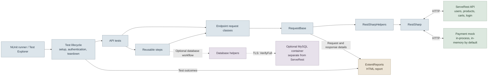
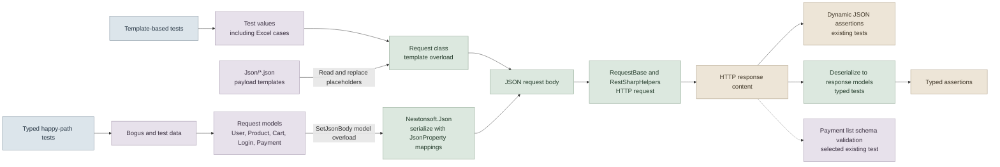
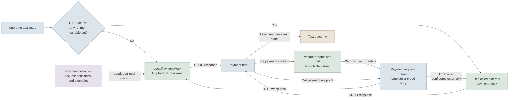

# RestSharp API Testing Playbook

A .NET API testing project using **NUnit**, **RestSharp**, and **Newtonsoft.Json**. It exercises users, products, carts, login, and a payment mock. Existing tests use JSON templates and Excel data; a separate happy-path suite uses typed C# models and Bogus-generated data.

> **Safety:** Some existing tests delete *all* users, products, or payments they find. Run them only against disposable, dedicated test services. Do not point the suite at production or shared environments.

## Contents

- [Quick start](#quick-start)
- [Architecture](#architecture)
- [Repository map](#repository-map)
- [Test coverage](#test-coverage)
- [Configuration and authentication](#configuration-and-authentication)
- [Running tests](#running-tests)
- [Payment mock](#payment-mock)
- [Optional local MySQL](#optional-local-mysql)
- [Adding a test](#adding-a-test)
- [Reports](#reports)
- [Code quality and Git hooks](#code-quality-and-git-hooks)
- [CI playbook](#ci-playbook)
- [Troubleshooting](#troubleshooting)

## Quick start

The examples use PowerShell from the repository root. You need:

- The **.NET 10 SDK** and Git.
- A running Docker-compatible engine, such as Rancher Desktop configured with `dockerd` or Docker Desktop.
- Network access to restore NuGet packages and, on the first run, pull the ServeRest image.

MySQL and OpenSSL are **not required** for the standard API suite.

```powershell
dotnet --version
docker version
dotnet restore RestSharpNunitApiTesting.sln
.\scripts\Test-LocalServeRest.ps1
```

The script starts a disposable ServeRest container, creates a temporary administrator, runs the API suites sequentially, and removes the container. Payment requests go to a local in-process mock. A nonzero test result, a startup failure, or zero matched tests causes the script to fail.

Run one test or only the typed suite:

```powershell
.\scripts\Test-LocalServeRest.ps1 -Filter "FullyQualifiedName~ListRegisteredCarts"
.\scripts\Test-LocalServeRest.ps1 -Filter "FullyQualifiedName~TypedApiHappyPathTests"
```

Open the generated ExtentReports HTML file under `bin\Debug\net10.0\Reports\` after the run. See [Reports](#reports) for details.

## Architecture



### Request execution chain

1. A fixture in [Tests](./RestsharpNunitApiTesting/Tests/) arranges data and either calls an endpoint class directly or uses a workflow in [Steps](./RestsharpNunitApiTesting/Steps/). Steps can compose several requests, such as creating a product before creating a cart.
2. A class in [Requests](./RestsharpNunitApiTesting/Requests/) selects the HTTP method, route, base URL, and request body. For example, [PostProduct](./RestsharpNunitApiTesting/Requests/Products/PostProduct.cs) targets `POST /produtos`.
3. [RequestBase](./RestsharpNunitApiTesting/Bases/RequestBase.cs) supplies shared headers and executes the request through [RestSharpHelpers](./RestsharpNunitApiTesting/Helpers/RestSharpHelpers.cs). Configuration comes from [JsonBuilder](./RestsharpNunitApiTesting/Helpers/JsonBuilder.cs); authentication is prepared by [LoginStep](./RestsharpNunitApiTesting/Steps/LoginStep.cs).
4. RestSharp sends the HTTP request to ServeRest or the payment service. The response returns to the test for assertions; request/response details are also sent to ExtentReports.

The arrows represent dependencies and data flow, not a requirement for every test to use every layer: some tests call request classes without a step, and database workflows are optional.

### Test data, models, and JSON



- **Template path:** Existing request overloads read files from [Json](./RestsharpNunitApiTesting/Json/) and replace placeholders with test values. For example, `PostProduct.SetJsonBody(name, price, description, quantity)` reads `Product.json`. Some tests obtain their input from [Serverest.xlsx](./RestsharpNunitApiTesting/DataDriven/Serverest.xlsx).
- **Typed path:** [TypedApiHappyPathTests](./RestsharpNunitApiTesting/Tests/TypedApiHappyPathTests.cs) builds objects from [Models](./RestsharpNunitApiTesting/Models/), using Bogus for random values. A typed `SetJsonBody` overload serializes the object; `[JsonProperty]` maps C# property names to the API's JSON keys. This path does not need the JSON template files.
- **Response path:** Both approaches receive HTTP response content. Existing tests often deserialize it dynamically; typed tests use `JsonConvert.DeserializeObject<T>` and assert properties on response models. The payment list test additionally checks [Payment.json](./RestsharpNunitApiTesting/Schemas/Payment.json) as a response schema.

### Payment test and mock dependencies



Payment tests call the payment request classes over HTTP; they do not execute the Postman collection as a server. When `URL_MOCK` is unset, setup loads the collection into the local mock and supplies its loopback URL. When it is set, the request classes use the external service instead. Tests that create payments first obtain cart data from ServeRest; missing-ID and mock-validation cases do not require that same preparation.

The local mock's state is reset between payment tests and typed tests. It provides in-memory CRUD behavior based on the collection examples, not real payment processing. The typed fixture tracks its created payment IDs for cleanup; older payment workflows may delete all payments in the target service.

### Execution lifecycle

1. The NUnit [one-time setup](./RestsharpNunitApiTesting/Bases/ReportSetUpFixture.cs) starts local services when their environment overrides are absent and creates the HTML reporter.
2. Before each test, [TestBase](./RestsharpNunitApiTesting/Bases/TestBase.cs) creates a report entry and prepares authentication. The local payment state is reset before each `PaymentTests` test; the typed fixture also resets it in its own setup.
3. A test prepares data, invokes request classes, and asserts HTTP status and response content. `RequestBase` and `RestSharpHelpers` construct and execute the request and record its details.
4. The typed fixture creates a unique administrator per test, switches to its token, tracks its own resources, and attempts to remove them during teardown. Several older fixtures have broader cleanup behavior.
5. One-time teardown flushes the report and stops the in-process mock and any ServeRest container started by the test process. The isolated runner manages its own ServeRest container in a PowerShell `finally` block.

The runner uses `NUnit.NumberOfTestWorkers=0`; the typed and payment fixtures are also marked nonparallelizable. The tests share mutable API state and runtime configuration, so do not enable parallel execution without redesigning isolation.

The Compose MySQL service supports the repository's database helper and SQL assets. It is **not** the ServeRest container's database, and the normal isolated API suite does not require MySQL.

## Repository map

| Location | Purpose |
| --- | --- |
| [Tests](./RestsharpNunitApiTesting/Tests/) | NUnit API scenarios and the typed happy-path fixture. |
| [Requests](./RestsharpNunitApiTesting/Requests/) | Endpoint-specific methods, paths, and request-body builders. |
| [Bases](./RestsharpNunitApiTesting/Bases/) | Shared request/test lifecycle, local ServeRest, and payment mock. |
| [Steps](./RestsharpNunitApiTesting/Steps/) | Reusable workflows such as login, creating products, and preparing carts. |
| [Models](./RestsharpNunitApiTesting/Models/) | Typed request/response DTOs and JSON property mappings. |
| [Json](./RestsharpNunitApiTesting/Json/) | Template payloads for existing tests. |
| [DataDriven](./RestsharpNunitApiTesting/DataDriven/) | Excel fixtures. `DataDrivenStep` currently reads row 2 from worksheets 1 and 2. |
| [Postman](./RestsharpNunitApiTesting/Postman/) and [Schemas](./RestsharpNunitApiTesting/Schemas/) | Payment collection/examples and JSON schema. |
| [Helpers](./RestsharpNunitApiTesting/Helpers/), [DatabaseSteps](./RestsharpNunitApiTesting/DatabaseSteps/), [Queries](./RestsharpNunitApiTesting/Queries/) | HTTP, configuration, reporting, data, and database utilities. |
| [scripts](./scripts/) | Isolated test runner and local MySQL certificate generation. |
| [docker/mysql](./docker/mysql/) and [docker-compose.yml](./docker-compose.yml) | Optional MySQL image, TLS configuration, and initial schema. |

Important libraries include NUnit and its test adapter, RestSharp, Newtonsoft.Json, Bogus, ExtentReports, ClosedXML, and MySql.Data. See the [project file](./RestSharpNunitApiTesting.csproj) for the complete dependency list and versions.

## Test coverage

The typed suite has one happy-path test per HTTP **method and route**, not just one per resource:

| Service | Operations |
| --- | --- |
| Login | `POST /login` |
| Users | `GET`, `POST /usuarios`; `GET`, `PUT`, `DELETE /usuarios/{id}` |
| Products | `GET`, `POST /produtos`; `GET`, `PUT`, `DELETE /produtos/{id}` |
| Carts | `GET`, `POST /carrinhos`; `GET /carrinhos/{id}`; `DELETE /carrinhos/cancelar-compra`; `DELETE /carrinhos/concluir-compra` |
| Payments, on the mock | `GET`, `POST /pagamento/tipoPagamento`; `GET`, `PUT`, `DELETE /pagamento/tipoPagamento/{id}` |

The other fixtures include positive and negative scenarios, including duplicate data, missing IDs, invalid login, payment method changes, and payment mock validation. Some user and product cases are sourced from Excel. A payment list test also validates a JSON schema.

Typed tests verify more than successful status codes: they compare IDs and fields, check cart totals, retrieve updates, and confirm deletions. The payment tests validate the mock's contract, **not** a real payment provider or end-to-end payment processing.

## Configuration and authentication

Settings are resolved by [JsonBuilder](./RestsharpNunitApiTesting/Helpers/JsonBuilder.cs) in this order:

1. Nonempty in-process runtime overrides.
2. Nonempty environment variables.
3. Values in [appsettings.json](./RestsharpNunitApiTesting/appsettings.json).

Local test startup supplies runtime URLs and credentials. Do not commit credentials to `appsettings.json`, the repository, reports, or logs. Environment variables belong to the process running the tests; a Compose `.env` file does **not** automatically export them to `dotnet test`.

| Setting | Purpose |
| --- | --- |
| `URL` | Base URL for ServeRest requests, including a trailing `/`. If the environment variable is absent, test startup creates a local container and overrides the appsettings URL. |
| `URL_MOCK` | Payment base URL, including a trailing `/`. If the environment variable is absent, startup uses the in-process mock, regardless of the appsettings URL. |
| `AUTHENTICATOR_USER`, `AUTHENTICATOR_PASSWORD` | Credentials for the test administrator. Per-test setup logs in when both are supplied. |
| `TOKEN` | Existing authorization value, including its `Bearer ` prefix, when credentials are not supplied. It must remain valid; token recovery may require the administrator credentials. |
| `NAME`, `ADMINISTRATOR`, `USER_ID` | Local administrator creation and existing workflows; `ADMINISTRATOR` defaults to the string `true`. |
| `REPORT_NAME`, `REPORT_SUBSTRING_LENGTH` | HTML report naming and category extraction. Defaults are in appsettings. |
| `DB_URL`, `DB_PORT`, `DB_NAME`, `DB_USER`, `DB_PASSWORD` | Optional MySQL connection settings. The default port is `3306`. |
| `DB_SSL_CA`, `DB_CONNECTION_TIMEOUT` | Optional trusted CA PEM path and query timeout; the default timeout is `50` seconds. |

When `URL` is unset, local startup generates an administrator email and password. Per-test setup logs in and creates that user on the loopback API when necessary. Request construction validates the token; the existing recovery path may attempt to log in, create, or delete the configured test administrator. The typed fixture temporarily uses a separate generated administrator and restores the previous token during teardown. Use dedicated accounts and services even for filtered runs.

For a dedicated external test environment, set `URL` and provide administrator credentials or a valid token through your secret manager/environment. Set `URL_MOCK` only if a dedicated stateful payment mock is available. The isolated PowerShell runner deliberately overrides `URL` and clears `URL_MOCK`; use `dotnet test` or Test Explorer to use explicit external overrides.

## Running tests

### Isolated runner

```powershell
dotnet restore RestSharpNunitApiTesting.sln
.\scripts\Test-LocalServeRest.ps1
.\scripts\Test-LocalServeRest.ps1 -Filter "FullyQualifiedName~PaymentTests"
.\scripts\Test-LocalServeRest.ps1 -Filter "FullyQualifiedName~TypedApiHappyPathTests.PostLogin_AuthenticatesUser"
```

`-Filter` is a `dotnet test` filter expression, intersected with the supported isolated test fixtures. The script starts `paulogoncalvesbh/serverest:2.29.7` on a random loopback port, polls `/usuarios`, creates a temporary administrator, and runs tests with no implicit restore. It restores the process settings, removes its temporary TRX file, and stops its container in `finally`.

### Direct execution and Test Explorer

With `URL` and `URL_MOCK` unset in the test process, one-time setup starts its own local services. This supports running an individual NUnit test from VS Code Test Explorer or from the CLI:

```powershell
dotnet restore RestSharpNunitApiTesting.sln
dotnet test RestSharpNunitApiTesting.sln --no-restore --filter "FullyQualifiedName~TypedApiHappyPathTests.PostLogin_AuthenticatesUser" -- NUnit.NumberOfTestWorkers=0
```

An explicitly set `URL` or `URL_MOCK` selects the corresponding external service instead. Check the environment inherited by your IDE and terminal before executing tests. Restart the test host if it inherited stale environment settings.

## Payment mock

The [Postman collection](./RestsharpNunitApiTesting/Postman/ServeRestMockApi.postman_collection.json) contains requests and saved response examples; it is **not** an executable server. [LocalPaymentMock](./RestsharpNunitApiTesting/Bases/LocalPaymentMock.cs) reads its five expected request definitions, success statuses, and update/delete messages, then runs a loopback-only `HttpListener` with in-memory CRUD state.

- A created payment receives an `idPagamento`; list and lookup return stored values.
- Create/update require the payment JSON structure and boolean/integer field types. Invalid JSON or data returns `400`; missing IDs return `404`.
- The mock resets between relevant tests and stops with the test process. No payment state persists between runs.
- The mock does not simulate a real payment provider. If `URL_MOCK` is explicitly set, the external service must implement the same stateful contract; local-mock-specific validation cases are skipped.

The collection's payment payload uses `pix` and `boleto` booleans; `credito` contains `credito_status` and `juros` booleans plus integer `qteParcelas`. Keep collection examples, models, mock validation, and assertions aligned when changing this contract.

## Optional local MySQL

Use this service only for work involving the repository's database helpers or SQL-backed workflows. The supplied initialization schema creates `produtos` and `usuarios`; these tables are separate from ServeRest. Some older database calls are currently commented out in the API fixtures, so starting MySQL alone does not add database assertions to the suite.

### Prerequisites and setup

You need Docker Compose and the **OpenSSL command-line tool** on `PATH`. OpenSSL is used to generate a local CA and server certificate; it is not a desktop application required by the tests. Do not share the generated private keys.

1. Copy the example environment file and replace the password placeholders with distinct, locally generated passwords:

   ```powershell
   Copy-Item .env.example .env
   ```

   Choose strong local-only credentials. Alphanumeric passwords avoid escaping issues with both Compose and PowerShell's `ConvertFrom-StringData`. `.env` is ignored by Git.

2. Generate certificates:

   ```powershell
   .\scripts\New-LocalMySqlCertificates.ps1
   ```

   The script refuses to overwrite existing keys or certificates. It creates a local CA and a server certificate valid for `localhost` and `127.0.0.1`; inspect and explicitly remove old certificate files before deliberately regenerating them.

3. Build and start MySQL, then inspect its health:

   ```powershell
   docker compose up -d --build
   docker compose ps
   docker compose logs mysql
   ```

4. Export settings to the **same PowerShell process** that will launch database-dependent code:

   ```powershell
   $localDb = Get-Content ".\.env" | ConvertFrom-StringData
   $env:DB_URL = "127.0.0.1"
   $env:DB_PORT = $localDb.DB_PORT
   $env:DB_NAME = $localDb.DB_NAME
   $env:DB_USER = $localDb.DB_USER
   $env:DB_PASSWORD = $localDb.DB_PASSWORD
   $env:DB_SSL_CA = (Resolve-Path ".\docker\mysql\certs\ca.pem").Path
   ```

The host port binds only to `127.0.0.1` and defaults to `3306`; change `DB_PORT` in `.env` if it is occupied. MySQL requires secure transport. The MySQL helper uses `VerifyFull`, validating both the certificate chain and hostname/IP. The entrypoint copies mounted keys into the container with restricted permissions.

The named `mysql_data` volume persists across container stops. MySQL's initialization scripts and initial user/password settings are applied when the data directory is first created, **not** every time `.env` changes. `docker compose down` stops and removes the Compose containers but retains the volume. Deleting the volume destroys its data; do so only deliberately.

## Adding a test

1. Identify the service, method, route, expected status, response contract, authentication, and required state.
2. Reuse an existing class in [Requests](./RestsharpNunitApiTesting/Requests/) or add an endpoint-specific class derived from `RequestBase`.
3. Prefer typed DTOs for new request/response shapes. `JsonProperty` maps C# names to the API's JSON keys; for example, `UserRequest.Administrator` maps to `administrador`, which ServeRest expects as the **string** `"true"` or `"false"`. Payment flags, by contrast, are JSON booleans.
4. Generate valid data with Bogus, add a unique suffix where the API requires unique values, and retain actual IDs from create responses.
5. Assert the status and meaningful response fields or state changes. Verify updated/deleted state where appropriate; avoid relying on another test's execution order.
6. Clean up only the test's own resources, even on failure. For carts, cancel before deleting their products. Keep tests sequential while they share runtime authentication or service state.
7. Run the new test individually, then the affected fixture and isolated suite. Update the endpoint table or mock contract when behavior changes.

For example, the typed fixture creates a randomized product and checks the stored representation:

```csharp
[Test]
public void PostProducts_CreatesProduct()
{
    ProductRequest product = NewProduct();
    string id = CreateProduct(product);
    ProductResponse response = Read<ProductResponse>(
        new GetProductById(id).ExecuteRequest(), HttpStatusCode.OK);

    Assert.AreEqual(product.Name, response.Name);
    Assert.AreEqual(product.Price, response.Price);
}
```

Here `NewProduct`, `CreateProduct`, and `Read<T>` are helpers in [TypedApiHappyPathTests](./RestsharpNunitApiTesting/Tests/TypedApiHappyPathTests.cs). The create helper passes the model to `PostProduct.SetJsonBody`, records its ID for teardown, and deserializes the response. `RequestBase` serializes typed request objects with Newtonsoft.Json; the older template overloads remain available.

## Reports

Each NUnit run creates an ExtentReports Spark HTML report under:

```text
bin/<Configuration>/<TargetFramework>/Reports/<REPORT_NAME>_<timestamp>/
```

Open the HTML file in that directory. It records test outcomes, request method/URL, headers, request and response data, and status codes. The report helper redacts recognized credential fields and omits payloads it cannot safely parse, but redaction is not a guarantee for every possible secret or custom format. Tests can also write response content to the console. Review reports and logs before sharing, and use synthetic test data.

The isolated script uses a temporary TRX file to verify that tests ran, then deletes it; the HTML report is the retained report. An interrupted or forcibly terminated process may not finish flushing the report or cleaning up services.

## Code quality and Git hooks

The .NET SDK's formatter and built-in Microsoft analyzers check this C# project; no separate lint package is required. The baseline enforces formatting, unused imports (IDE0005), and correctness rules for recursive property accessors (CA2011), rethrowing exceptions (CA2200), and exception argument names (CA2208). Build warnings are treated as errors by the quality check. These are general .NET rules, not RestSharp-specific API checks.

After restoring packages, run:

```powershell
dotnet format RestSharpNunitApiTesting.sln --no-restore --verify-no-changes --severity warn
dotnet build RestSharpNunitApiTesting.sln --no-restore --no-incremental -warnaserror
```

To apply available fixes, run `dotnet format RestSharpNunitApiTesting.sln --no-restore` and review the changes.

Enable the repository's [pre-commit hook](./.githooks/pre-commit) once per clone:

```powershell
git config --local core.hooksPath .githooks
```

Check for an existing `core.hooksPath` or `.git\hooks\pre-commit` first; setting a new hook path bypasses hooks in the old location, so integrate any existing hooks as needed.

The hook runs the same checks, without Docker or integration tests. It checks the working tree: stage or stash tracked C# and build-configuration changes, and stage or remove untracked ones, so it does not validate different content from a partially staged file. Run `dotnet restore RestSharpNunitApiTesting.sln` before committing in a fresh clone.

When first adding the hook to Git from Windows, preserve its executable bit for other platforms:

```powershell
git add --chmod=+x .githooks/pre-commit
```

Git hooks are local and can be bypassed; run the checks in CI as well.

## CI playbook

The [API tests workflow](./.github/workflows/api-tests.yml) runs on pushes to `main`, pull requests, and manual dispatch. It uses an Ubuntu runner with the .NET 10 SDK, PowerShell, Git, and Docker, and performs the repository's standard checks:

```powershell
dotnet restore  RestSharpNunitApiTesting.sln
dotnet format  RestSharpNunitApiTesting.sln --no-restore --verify-no-changes --severity warn
dotnet build  RestSharpNunitApiTesting.sln --no-restore --no-incremental -warnaserror
.\scripts\Test-LocalServeRest.ps1
```

After a `main`-branch run, the workflow publishes one ExtentReports site to GitHub Pages, echoes the live URL, and adds a direct **HTML report** link to the job summary. The report is published even when tests fail, and the job still fails after publication so the CI result remains accurate. Pull-request runs execute the checks but do not replace the `main` Pages site.

GitHub Pages must use **GitHub Actions** as its build and deployment source in the repository settings. The workflow requires `pages: write` and `id-token: write` permissions; no additional repository secrets are needed.

The isolated runner generates temporary API credentials and starts the payment mock; no long-lived API or MySQL secret is required for this suite. Ensure the runner can pull the image and bind a loopback port. Add MySQL, generated certificates, and securely supplied environment variables only for jobs that exercise database workflows.

## Troubleshooting

| Symptom | Checks |
| --- | --- |
| Docker is unavailable or ServeRest never becomes ready | Run `docker version`, check the engine and image pull access, then inspect container logs. Rancher Desktop must use a Docker-compatible runtime. |
| A single test reports missing `TOKEN` or cannot authenticate | Clear stale `URL`/credential overrides for an isolated run; confirm the test process can start Docker. For an external API, provide a valid bearer token or dedicated administrator credentials. |
| Requests reach an unexpected service | Inspect `URL` and `URL_MOCK` in the test process. Environment overrides select external services; the script intentionally forces local services. Check for inherited IDE settings. |
| No tests matched the script filter | Check the fixture/test name and `FullyQualifiedName~...` expression. The script only selects its listed API fixtures. |
| Payment `400`, `404`, or schema failure | Inspect the JSON types and collection contract; make sure an external mock, if configured, supports stateful CRUD. |
| MySQL TLS or connection failure | Check `docker compose ps` and logs, the host port, `DB_SSL_CA`, and the certificate's hostname/IP. Do not disable certificate verification. |
| Changed MySQL credentials/schema have no effect | The existing named volume retains initialization data. Inspect it before deciding whether a deliberate data reset is appropriate. |
| Pre-commit rejects changes before linting | Stage or stash relevant tracked files and stage or remove relevant untracked files. Restore packages, run the two quality commands above, and fix any reported violations. |
| Report or container remains after interruption | Inspect `bin\Debug\net10.0\Reports\` and `docker ps`. Identify the specific temporary container before stopping it; do not remove unrelated containers or volumes. |
